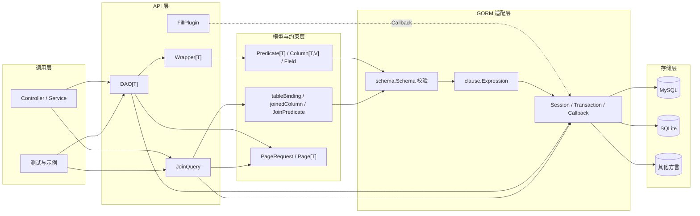
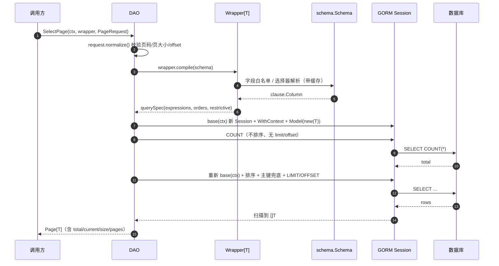
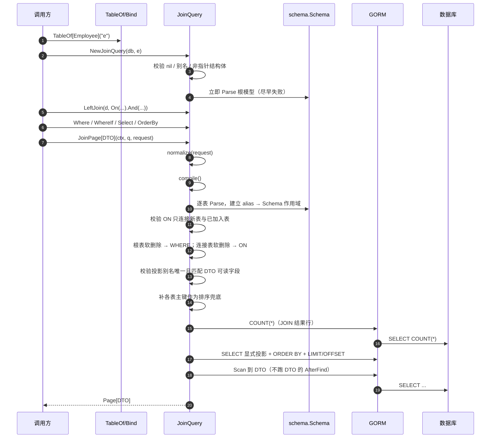
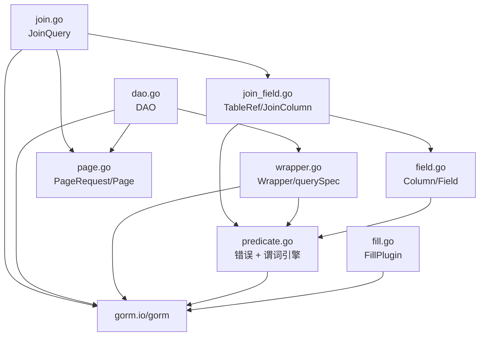

# 01 整体架构

[返回 Wiki 首页](README.md)

## 1. 分层视图

gormx 是一个单包库（`package gormx`），内部按“API → 条件编译 → GORM 执行”分层，不在包内再拆子包。



| 层 | 职责 | 不应做的事 |
| --- | --- | --- |
| 调用层 | 参数解析、权限判定、业务编排、事务边界 | 不拼接 SQL、不把客户端字段任意映射为更新列 |
| API 层 | 统一入口、不可变链式 API、分页封装 | 不实现 ORM 能力、不缓存业务数据 |
| 模型与约束层 | 编译期类型约束、条件闭包、Schema 映射 | 不直接执行 SQL |
| GORM 适配层 | 生成 `clause`、Session 隔离、事务与 Hook | 不替换 GORM 的方言/连接池/软删除 |
| 存储层 | 实际数据库 | — |

## 2. 一次单表查询的生命周期

以 `dao.SelectPage(ctx, wrapper, request)` 为例：



关键点：

- `normalize()` 在编译条件前执行，非法分页不会触达数据库。
- count 与 select 使用**两个独立 Session**，避免排序、limit、offset、查询状态互相污染。
- 任一查询失败立即返回错误，不返回半成功 `Page`；`SelectPage` 失败时直接返回 `nil, err`。

## 3. 一次多表查询的生命周期



## 4. 关键设计决策

| 决策 | 实现 | 影响 |
| --- | --- | --- |
| 组合而非继承 | `DAO[T]` + `Wrapper[T]` + `Page[T]` | 无隐式 DAO 方法爆炸，业务自由组合条件 |
| 不可变查询 | 每次链式调用复制切片 | 基础 Wrapper 可安全派生多条查询并可并发复用 |
| 编译期 + 运行期双层校验 | `Column[T,V]` 约束值类型；`schema.LookUpField` 校验真实列 | 字段重命名编译失败；未知/忽略字段运行期报错 |
| 条件不拼 SQL | 普通值走 `clause` 参数绑定 | 避免注入面；但显式 `gorm.Expr` 仍具 SQL 能力，需应用层禁止 |
| 写操作强制限制条件 | `querySpec.restrictive` | 空 Wrapper、仅排序、恒真条件拒绝更新/删除 |
| 两个独立 Session | `db.Session(&gorm.Session{})` | 防止链式查询状态复用导致条件泄漏 |
| 分页固定两次查询 | COUNT 后 SELECT | 语义清晰、无插件；代价是大表 count 与深 OFFSET |
| 软删除复用 GORM | 不注册竞争性删除回调 | 保留 `BeforeDelete/AfterDelete` 与原生 `Unscoped` 路径 |
| 连表独立 API | `JoinQuery` 不改 `DAO`/`Wrapper` | 多表能力可单独灰度和回退 |
| 连表分页统计结果行 | `COUNT(*)` JOIN 行 | 避免“去重 count + LIMIT”截断子列表的隐式错误 |

设计动因详见 [design.md](../design.md)；连表取舍详见 [joins.md](../joins.md)。

## 5. 构造边界：为什么必须传原始 DB

`NewDAO` 与 `NewJoinQuery` 都会执行：

```go
db.Session(&gorm.Session{NewDB: true})
```

`NewDB` 会开启一个干净语句，**丢弃调用前预挂的 WHERE、Scope、排序、分页**，但保留：

- 数据库连接与连接池
- 当前事务句柄
- 已注册插件与 Callback
- 命名策略（NamingStrategy）与方言

因此：

```go
// 错误期望：租户条件不会自动保留
dao, _ := gormx.NewDAO[User](db.Where("tenant_id = ?", tenantID))

// 正确做法：显式写入 Wrapper
q := gormx.NewWrapper[User]().Eq("TenantID", tenantID)
```

该约定**不是多租户权限框架**。依赖 GORM Scope 的复杂业务应继续使用原生 GORM，或把权限条件显式写入每一层查询（连表时每张表都要覆盖）。

## 6. 错误模型

所有哨兵错误定义在 [predicate.go](../../predicate.go)：

| 错误 | 含义 | 典型触发点 |
| --- | --- | --- |
| `ErrInvalidModel` | 模型必须是非指针结构体 | `NewDAO`、`TableOf`、`JoinPage` 的 DTO |
| `ErrInvalidField` | 字段不存在、被忽略、选择器非法、投影无对应 DTO 字段 | `LookUpField` 失败、`Field` 选择器返回 nil/非模型字段 |
| `ErrInvalidQuery` | 查询结构非法 | 空条件组、空 `JoinAll/JoinAny`、非法别名、ON 结构错误、未知模型级 QueryClause |
| `ErrUnsafeWrite` | 更新/删除缺少有效限制条件 | 空 Wrapper、仅排序、全部条件关闭、`NotIn(empty)` |
| `ErrInvalidPage` | 分页参数非法 | 负数、`size > 500`、offset 溢出 |
| `ErrInvalidID` | 主键非法 | `ByID` 传 nil、空字符串、数字字符串无法解析、非整数/字符串主键 |

行为约定：

- 错误通过 `errors.Is` 可判别；字段错误会用 `%w` 包装具体字段名。
- `First/GetByID` 保留 `gorm.ErrRecordNotFound`。
- `List` 无记录返回**非 nil 空切片**和 nil error。
- `Update/Delete` 返回数据库报告的 `RowsAffected`；MySQL 的“匹配行/改变行”语义受连接参数影响。

## 7. 并发模型

| 对象 | 并发安全性 | 说明 |
| --- | --- | --- |
| `Wrapper[T]` | 可并发复用 | 链式方法只读自身并复制切片；不要并发修改传入的 map/slice 元素 |
| `DAO[T]` | 可并发使用 | 每次操作创建独立 Session 与新的 `Model(new(T))` 指针 |
| `JoinQuery` | 可并发复用 | 不可变；`compile()` 每次生成独立 `joinPlan` |
| `FillPlugin` | 注册一次后只读 | 必须在服务开始并发处理请求前 `db.Use` |
| 实体指针/切片元素 | 非线程安全 | 由调用方负责 |

`DAO.base` 特意在每次调用时 `Model(new(T))`，因为 GORM 会把赋值结果写回 Model 指针，共享同一个 `new(T)` 会产生竞态。

## 8. 包内依赖方向



规则：

- `predicate.go` 是底座，不依赖其他 gormx 文件。
- 单表链路（`field/wrapper/dao`）与多表链路（`join_field/join`）只在错误值与 `Column`/`Field` 上复用，不互相调用执行逻辑。
- `fill.go` 独立于 DAO/Wrapper，可单独注册或移除。

详细依赖清单见 [07 依赖关系](07-dependencies.md)。

## 9. 源码索引

| 关注点 | 位置 |
| --- | --- |
| 包注释与 DAO 构造 | [dao.go](../../dao.go#L1-L46) |
| 条件引擎 | [predicate.go](../../predicate.go#L21-L158) |
| Lambda 字段解析与缓存 | [field.go](../../field.go#L22-L71) |
| Wrapper 编译 | [wrapper.go](../../wrapper.go#L159-L202) |
| 分页规范化 | [page.go](../../page.go#L24-L39) |
| 连表编译 | [join.go](../../join.go#L162-L250) |
| 填充插件 | [fill.go](../../fill.go#L36-L139) |
