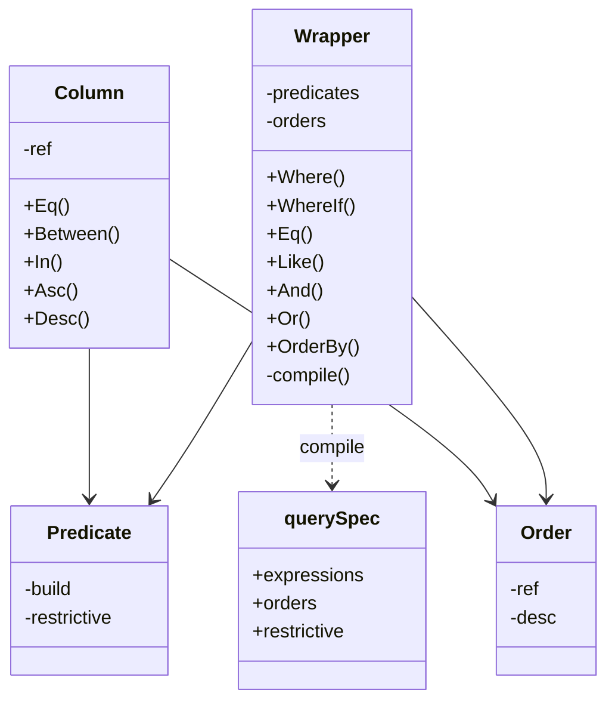
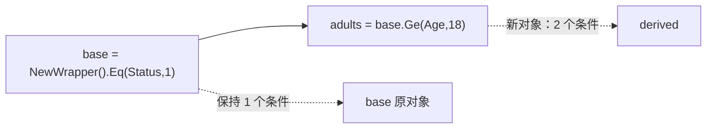
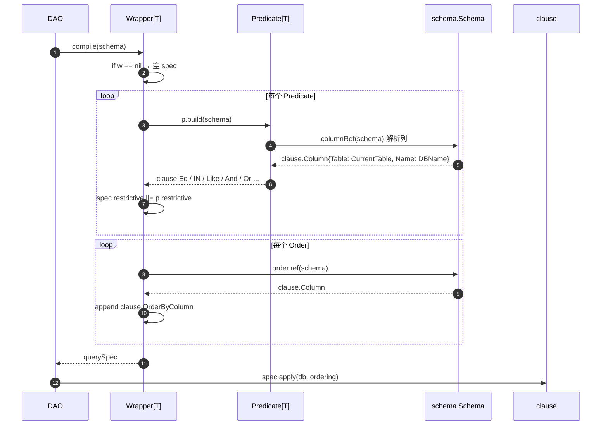
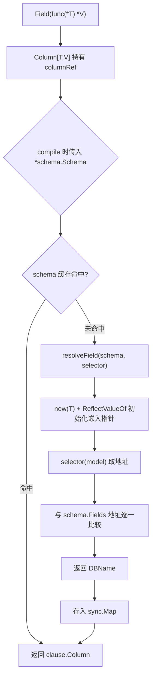

# 02 条件引擎：Wrapper / Predicate / Column

[返回 Wiki 首页](README.md)

## 1. 模块目标

条件引擎负责把业务筛选条件转换成 GORM 可执行的 `clause.Expression`，并在过程中完成：

1. **字段白名单校验**：只允许模型上真实映射的字段，拒绝未知字段、忽略字段和 SQL 片段。
2. **值参数化绑定**：普通值不拼接进 SQL 字符串。
3. **不可变组合**：任何链式调用都不修改原对象。
4. **写安全标记**：为 `Update/Delete` 记录“条件是否具有限制性”。
5. **编译期类型约束**（Lambda 风格）：字段选择与值类型绑定。

相关源码：

- [wrapper.go](../../wrapper.go)
- [predicate.go](../../predicate.go)
- [field.go](../../field.go)

## 2. 类型关系



| 类型 | 是否导出 | 作用 |
| --- | --- | --- |
| `Wrapper[T]` | 是 | 对外查询构建器，字符串风格与 Lambda 风格共用 |
| `Predicate[T]` | 是（零值无效） | 绑定模型类型的一个条件单元；支持 `All/Any` 分组 |
| `Column[T,V]` | 是 | 绑定模型 `T` 与值类型 `V` 的字段；`Eq/In` 等方法在编译期约束值 |
| `Order[T]` | 是 | 绑定模型的排序项 |
| `columnRef[T]` | 否 | `func(*schema.Schema) (clause.Column, error)`，延迟到编译期解析列 |
| `querySpec` | 否 | 编译产物：表达式、排序、写限制标记 |

## 3. 公共 API

### 3.1 Wrapper 构建

| 方法 | 签名 | 说明 |
| --- | --- | --- |
| `NewWrapper[T]` | `func NewWrapper[T any]() *Wrapper[T]` | 创建空查询 |
| `NewLambda[T]` | `func NewLambda[T any]() *Wrapper[T]` | 同引擎别名，语义上强调 Lambda 风格 |
| `Where` | `(...Predicate[T]) *Wrapper[T]` | 追加顶层 AND 条件 |
| `WhereIf` | `(bool, ...Predicate[T]) *Wrapper[T]` | 条件为真时追加；实参仍会先被求值 |
| `And` | `(func(*Wrapper[T]) *Wrapper[T]) *Wrapper[T]` | 追加一个内部 AND 的括号组 |
| `Or` | `(func(*Wrapper[T]) *Wrapper[T]) *Wrapper[T]` | 追加一个内部 OR 的括号组，组间仍为 AND |
| `OrderBy` | `(...Order[T]) *Wrapper[T]` | 追加排序 |
| `OrderByAsc/OrderByDesc` | `(...string) *Wrapper[T]` | 字符串字段排序 |

### 3.2 字符串字段条件

字段名接受 **Go 字段名** 或 **数据库列名**，统一经 `schema.LookUpField` 校验。

| 方法 | 生成条件 |
| --- | --- |
| `Eq(field, value)` / `EqIf` | `col = ?` |
| `Ne` | `col <> ?` |
| `Gt/Ge/Lt/Le` | `col > / >= / < / <= ?` |
| `Like(field, pattern)` / `LikeIf` | `col LIKE ?` |
| `NotLike` | `col NOT LIKE ?` |
| `In(field, values)` | `col IN (...)`；空集合恒假 |
| `NotIn` | `col NOT IN (...)`；空集合恒真 |
| `Between(field, lower, upper)` | `col >= ? AND col <= ?` |
| `IsNull` / `IsNotNull` | `col IS NULL` / `col IS NOT NULL` |

### 3.3 Lambda 字段与条件

```go
var (
    UserName = gormx.Field(func(u *User) *string { return &u.Name })
    UserAge  = gormx.Field(func(u *User) *int { return &u.Age })
)

q := gormx.NewLambda[User]().
    WhereIf(name != "", gormx.Like(UserName, "%"+name+"%")).
    Where(UserAge.Between(18, 40)).
    OrderBy(UserAge.Desc())
```

`Column[T,V]` 方法：

| 方法 | 签名 | 说明 |
| --- | --- | --- |
| `Eq/Ne/Gt/Ge/Lt/Le` | `(V) Predicate[T]` | 值类型由 `V` 固定 |
| `Between` | `(lower, upper V) Predicate[T]` | 等价于 `All(Ge, Le)` |
| `In/NotIn` | `(...V) Predicate[T]` | 可变参数 |
| `IsNull/IsNotNull` | `() Predicate[T]` | 与 nil 比较 |
| `Asc/Desc` | `() Order[T]` | 排序 |
| `Like`（顶层函数） | `Like[T any](Column[T,string], string) Predicate[T]` | 仅接受字符串字段 |

`Column` 的零值无效；`Field` 的 selector 必须返回模型字段地址，且应为纯函数。

## 4. 不可变语义



实现方式：`clone()` 复制 `predicates` 与 `orders` 两个切片，链式方法在副本上追加。

```go
base := gormx.NewWrapper[User]().Eq("Status", 1)
adults := base.Ge("Age", 18) // base 不变
```

约定：

- **必须接住返回值**：`q.Where(...)` 不修改 `q`。
- 未接住返回值不会报错，但条件会丢失，属于常见误用。
- `In` 只复制切片容器，不做元素深拷贝；不要并发修改元素。
- nil receiver 可安全用于 `clone`/`Where` 等链式方法，但不要把 nil 当作有效查询传给 DAO 以外的场景（`compile` 会把 nil 当作空条件）。

## 5. 条件编译流程



`apply` 的行为：

```go
if len(s.expressions) > 0 {
    db = db.Clauses(clause.Where{Exprs: s.expressions})
}
if ordering && len(s.orders) > 0 {
    db = db.Clauses(clause.OrderBy{Columns: s.orders})
}
```

所有顶层条件由 `clause.Where` 以 AND 组合；`Or(...)`/`Any(...)` 内部使用 `clause.Or`。

## 6. 写安全标记 `restrictive`

`Predicate.restrictive` 用来识别“显然恒真”的条件，让 `Update/Delete` 拒绝无条件写入。

| 条件 | restrictive | 说明 |
| --- | --- | --- |
| `Eq/Ne/Gt/Ge/Lt/Le/Like/NotLike` | `true` | 普通比较视为有限制性 |
| `In(empty)` | `true` | SQL 为 `1 = 0`，影响 0 行，允许 |
| `NotIn(empty)` | `false` | SQL 为 `1 = 1`，恒真，拒绝写 |
| `All(a, b, ...)`（AND 组） | 任一子条件为 `true` 即为 `true` | 顶层条件本身就是 AND 语义 |
| `Any(a, b, ...)`（OR 组） | 非空且所有子条件都为 `true` 才为 `true` | 任一子条件恒真则整组可能恒真 |
| 空 `All/Any` | — | 编译时报 `ErrInvalidQuery` |
| 仅排序 / 空 Wrapper | `false` | 更新/删除返回 `ErrUnsafeWrite` |

注意：

- 这是**结构检查**，不是逻辑证明。`Like("%")`、`Eq("ID", 1)` 之类仍可能覆盖大量行，业务授权必须由应用层负责。
- `In(empty)` 允许写操作，但实际影响 0 行；`NotIn(empty)` 会被拒绝。
- 显式传入 `gorm.Expr` 不属于普通参数，具有执行 SQL 的能力，应用层不得把用户输入包装成表达式。

详见 [03 DAO 与 CRUD](03-dao-crud.md#7-写保护) 与 [09 边界](09-boundaries.md)。

## 7. Lambda 字段解析与缓存



关键细节：

| 细节 | 行为 |
| --- | --- |
| 缓存粒度 | 每个 `Column` 内部一个 `sync.Map`，key 是 `*schema.Schema` |
| 命名策略隔离 | 不同 NamingStrategy 产生不同 Schema，缓存互不污染 |
| 嵌入字段 | 依赖 GORM 的 `ReflectValueOf` 初始化 nil 嵌入指针，支持 `embeddedPrefix` |
| 非法选择器 | 返回 nil、越界地址、未映射字段 → `ErrInvalidField` |
| 选择器 panic | `recover` 后包装为 `ErrInvalidField` |
| 列名 | 返回 `clause.Column{Table: clause.CurrentTable, Name: DBName}` |

类型安全边界（源自 [design.md](../design.md#层次-2双风格-wrapper)）：

| 检查项 | 阶段 |
| --- | --- |
| 字段是否存在、字段重命名、`Age.Eq("18")` 参数不匹配 | Go 编译期 |
| 条件属于哪个模型、能否交给对应 DAO | Go 编译期 |
| 地址是否来自当前模型、字段是否被忽略、真实列名 | 运行时 Schema 校验 |
| 运算符是否适合该数据库类型、值是否满足数据库约束 | 调用者与数据库 |

## 8. 空集合与零值语义

| 输入 | 行为 |
| --- | --- |
| `In(empty)` | `1 = 0`，恒不匹配；可安全用于“无结果” |
| `NotIn(empty)` | `1 = 1`，恒匹配；不可用于写操作 |
| `Eq(field, 0)` / `Eq(field, "")` / `Eq(field, false)` | 正常生成条件，零值不会被忽略 |
| `Eq(field, nil)` | `IS NULL` |
| `Ne(field, nil)` | `IS NOT NULL` |
| 非 slice/array 传给 `In` | 运行时 `ErrInvalidQuery` |

字符串 Wrapper 的 `In(field, values any)` 接受 slice/array；Lambda 的 `Column.In(values ...V)` 在调用侧天然是可变参数。

## 9. 常见陷阱

1. **`WhereIf`/`EqIf` 的实参会先求值**
   ```go
   // 若 status 为 nil，这里已经 panic
   q = q.EqIf(status != nil, "Status", *status)
   ```
   正确写法是先判空再调用，或用显式 `if`。

2. **忘记接住返回值**：Wrapper 不可变，`q.Where(...)` 的结果必须赋回。

3. **嵌套组里不能排序**：`And/Or` 的 build 函数返回的 Wrapper 若包含 `orders`，会生成无效条件并在编译期报 `ErrInvalidQuery`。

4. **`Or` 不是切换连接符**：`Or(func(q) ...)` 表示追加一个括号组，组与组之间仍是 AND。

5. **字符串字段名不是任意 SQL**：`"Status = 1 OR 1=1"` 会被当作字段名并在编译期拒绝。

6. **Like 通配符保留数据库语义**：`%`、`_` 不做转义，需要字面量匹配时由调用方处理。

7. **不要用客户端输入决定字段名**：字段白名单不等于业务字段授权。

## 10. 源码索引

| 关注点 | 位置 |
| --- | --- |
| `Order`/`Wrapper` 定义与不可变 clone | [wrapper.go](../../wrapper.go#L9-L41) |
| `WhereIf` 与嵌套 `And/Or` | [wrapper.go](../../wrapper.go#L37-L135) |
| 字符串条件方法 | [wrapper.go](../../wrapper.go#L51-L157) |
| `querySpec` 与 `compile/apply` | [wrapper.go](../../wrapper.go#L159-L202) |
| 哨兵错误 | [predicate.go](../../predicate.go#L12-L19) |
| 字符串列解析 | [predicate.go](../../predicate.go#L30-L38) |
| 比较/集合/分组 | [predicate.go](../../predicate.go#L40-L158) |
| `Column` 与 `Field` | [field.go](../../field.go#L13-L121) |
| 字段地址解析 | [field.go](../../field.go#L39-L71) |
