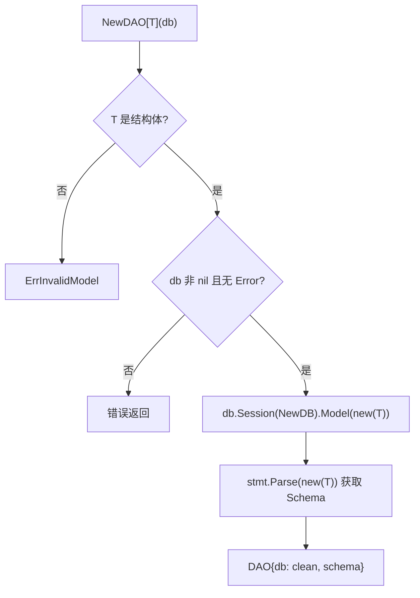
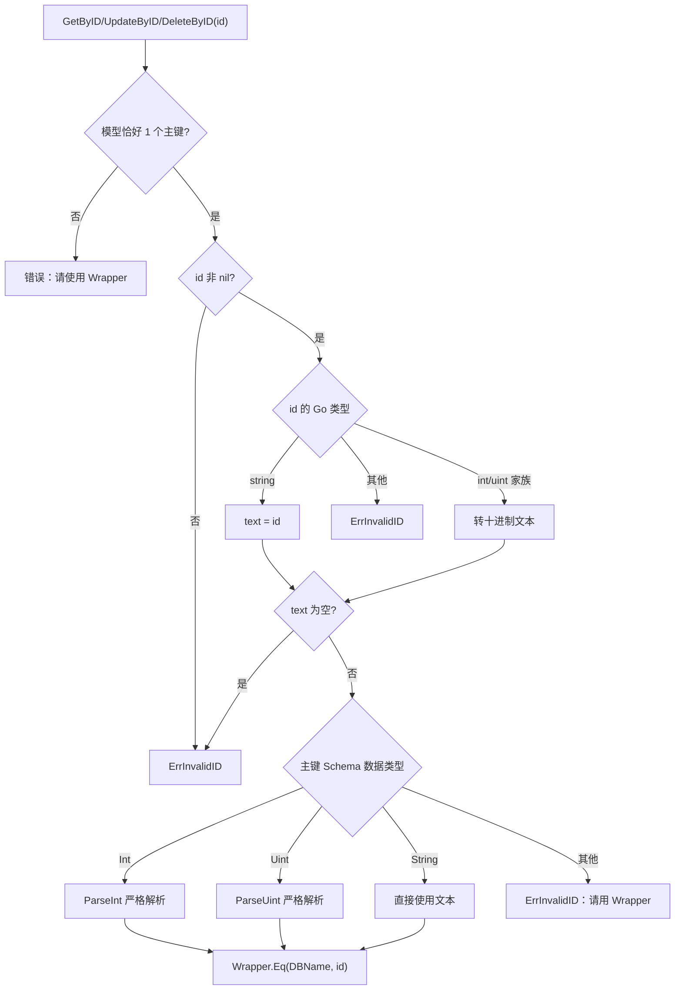
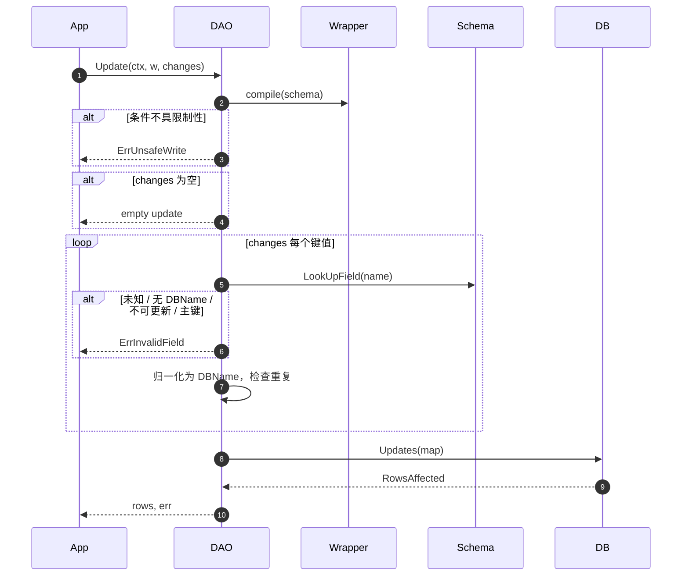

# 03 DAO 与 CRUD

[返回 Wiki 首页](README.md)

## 1. 职责

`DAO[T]` 是单表读写入口，负责：

- 校验并持有模型 Schema；
- 每次操作创建独立 GORM Session，避免查询状态泄漏；
- 把 `Wrapper[T]` 编译为条件并执行；
- 提供统一的 CRUD、批量、ByID 和事务 API；
- 对更新/删除执行写保护。

源码：[dao.go](../../dao.go)

## 2. 结构与构造

```go
type DAO[T any] struct {
    db     *gorm.DB
    schema *schema.Schema
}

func NewDAO[T any](db *gorm.DB) (*DAO[T], error)
```

构造流程：



| 检查 | 结果 |
| --- | --- |
| `T` 必须是非指针结构体 | 否则 `ErrInvalidModel` |
| `db == nil` | `gormx: nil database` |
| `db.Error != nil` | 原样返回该错误 |
| Schema 解析失败 | 返回 GORM 错误 |
| 预挂条件/Scope/排序/分页 | 被 `NewDB` 清除 |
| 连接、事务、插件、命名策略 | 保留 |

**构造边界**：只能传原始 DB 或事务句柄。不要传入 `db.Where("tenant_id = ?", id)` 并期望条件保留；租户条件必须显式写入 Wrapper。详见 [01 架构](01-architecture.md#5-构造边界为什么必须传原始-db)。

## 3. 每次操作的 Session 隔离

```go
func (d *DAO[T]) base(ctx context.Context) *gorm.DB {
    return d.db.Session(&gorm.Session{}).WithContext(ctx).Model(new(T))
}
```

两个关键点：

1. **新 Session**：GORM 的链式调用会在 Statement 上累积条件、排序、limit 等状态；复用同一 Statement 会让上一次查询的分页/排序泄漏到下一次。
2. **新的 `new(T)` 指针**：GORM 写操作会把赋值结果写回 Model 指针；并发复用同一个 Model 指针会产生数据竞态。

因此 `DAO[T]` 本身可以并发使用，实体和传入的 map/slice 元素由调用方保证不并发修改。

## 4. CRUD API

| 方法 | 签名 | 行为 |
| --- | --- | --- |
| `Create` | `(ctx, *T) error` | 单条新增；nil 实体报错；自增 ID 回填 |
| `CreateBatch` | `(ctx, []T, batchSize int) error` | 分批新增；`batchSize <= 0` 报错；空切片直接返回 nil |
| `GetByID` | `(ctx, id any) (*T, error)` | 单主键查询；无记录返回 `gorm.ErrRecordNotFound` |
| `First` | `(ctx, *Wrapper[T]) (*T, error)` | 条件查询第一条；保留 `ErrRecordNotFound` |
| `List` | `(ctx, *Wrapper[T]) ([]T, error)` | 无隐式上限；无记录返回非 nil 空切片 |
| `Count` | `(ctx, *Wrapper[T]) (int64, error)` | 只执行 COUNT，不应用排序 |
| `SelectPage` | `(ctx, *Wrapper[T], PageRequest) (*Page[T], error)` | 固定 COUNT + SELECT，详见 [04 分页](04-pagination.md) |
| `Update` | `(ctx, *Wrapper[T], map[string]any) (int64, error)` | 条件更新；保留零值；返回受影响行数 |
| `UpdateByID` | `(ctx, id any, map[string]any) (int64, error)` | 单主键更新 |
| `Delete` | `(ctx, *Wrapper[T]) (int64, error)` | 条件删除；支持原生软删除 |
| `DeleteByID` | `(ctx, id any) (int64, error)` | 单主键删除 |
| `Transaction` | `(ctx, func(*DAO[T]) error) error` | 同模型事务；回调返回错误则回滚 |

## 5. ByID 主键规则

`primaryQuery(id)` 将单个主键转换为 Wrapper，规则如下：



要点：

- 只支持**单个**整数或字符串主键；复合主键、UUID 特殊类型等请显式构造 Wrapper。
- 数字字符串会严格解析，避免 MySQL 把 `"12abc"` 隐式转换成 `12` 而命中错误记录。
- `id` 为空字符串、nil、不可解析时返回 `ErrInvalidID`。

## 6. 更新语义

```go
rows, err := dao.Update(ctx,
    gormx.NewWrapper[User]().In("ID", []uint{1, 2, 3}),
    map[string]any{"Status": 0, "Age": 0},
)
```

处理流程：



设计要点：

| 点 | 说明 |
| --- | --- |
| 使用 `map[string]any` | 保留 `0`、`false`、`""`，不会像结构体更新那样跳过零值 |
| 字段白名单 | 接受 Go 字段名或 DB 列名；未知字段、忽略字段、主键、非 `Updatable` 字段拒绝 |
| 重复字段 | `{"Name": ..., "name": ...}` 归一化后同列 → `ErrInvalidField` |
| 返回行数 | 数据库报告的 `RowsAffected`；MySQL 报告匹配行还是实际改变行受 DSN/参数影响 |
| 无 `Save` | 避免 `Save` 更新失败后退化为插入的隐式语义 |
| 类型校验 | 值是否能写入列由 GORM/数据库负责，gormx 不做 SQL 类型系统校验 |

## 7. 写保护

`Update` 与 `Delete` 都会检查 `querySpec.restrictive`：

```go
if !spec.restrictive {
    return 0, ErrUnsafeWrite
}
```

会被拒绝的典型情况：

- 空 Wrapper；
- 只有 `OrderBy`；
- 全部条件被 `WhereIf(false, ...)` 关闭；
- `NotIn(empty)`（恒真）；
- 顶层为恒真表达式（例如人为构造的 `gorm.Expr("1=1")`）。

不会被拒绝但需要业务负责的情况：

- `In(empty)`：允许，但影响 0 行；
- `Like("%")`、`Eq("Status", 1)` 等仍可能覆盖大量数据；
- 任意 `gorm.Expr`。

因此写保护只是**结构级安全网**，不是权限系统。字段授权、租户隔离、条件合法性仍由应用层负责。详见 [09 边界](09-boundaries.md)。

## 8. 删除与软删除

```go
rows, err := dao.Delete(ctx, gormx.NewWrapper[User]().Eq("ID", id))
```

- 模型声明 `gorm.DeletedAt` → GORM 执行逻辑删除（UPDATE deleted_at），查询与 count 自动过滤。
- 未声明 `gorm.DeletedAt` → 物理删除。
- 不额外注册删除 Callback；`BeforeDelete/AfterDelete` 保持可用。
- 恢复、物理清理、查看已删除记录需显式使用原生 GORM `Unscoped()`，并在应用层单独授权。

删除路径不会触发 Update 回调，因此 `UpdatedBy` 填充规则不会自动记录“删除人”。详见 [06 填充与软删除](06-fill-and-soft-delete.md)。

## 9. 事务

### 9.1 同模型事务

```go
err := dao.Transaction(ctx, func(txDAO *gormx.DAO[User]) error {
    if err := txDAO.Create(ctx, &user); err != nil {
        return err
    }
    _, err := txDAO.UpdateByID(ctx, user.ID, map[string]any{"Status": 1})
    return err
})
```

- 回调返回 nil → 提交；返回错误 → 回滚。
- 回调为 nil → 返回错误，不开启事务。
- 事务内重新 `NewDAO(tx)`，Schema 与连接保留。

### 9.2 跨模型事务与隔离级别

```go
err := db.WithContext(ctx).Transaction(func(tx *gorm.DB) error {
    users, err := gormx.NewDAO[User](tx)
    if err != nil {
        return err
    }
    _, err = users.SelectPage(ctx, query, request)
    return err
}, &sql.TxOptions{Isolation: sql.LevelRepeatableRead, ReadOnly: true})
```

- 跨模型时直接使用 GORM 事务句柄，分别构造各模型的 DAO。
- 需要 count 与 select 共享快照时，用合适隔离级别的事务包裹 `SelectPage`。
- `NewDAO(tx)` 同样会清空预先附加的查询条件，但**不会丢失事务连接**。

## 10. 错误与上下文

| 场景 | 返回 |
| --- | --- |
| 实体为 nil | `gormx: nil entity` |
| 批次大小非正 | `gormx: batch size must be positive` |
| 空批次 | `nil`（不执行 SQL） |
| 无记录（First/GetByID） | `gorm.ErrRecordNotFound` |
| 无记录（List/Page） | 非 nil 空切片 + nil error |
| 条件编译失败 | `ErrInvalidField` / `ErrInvalidQuery` |
| 写保护 | `ErrUnsafeWrite` |
| Context 取消 | GORM/驱动错误原样返回 |

所有执行方法显式接收 `context.Context`，通过 `WithContext(ctx)` 传递到驱动；取消、超时、追踪由 GORM 与数据库驱动处理。

## 11. 源码索引

| 关注点 | 位置 |
| --- | --- |
| 包注释与 `DAO` 定义 | [dao.go](../../dao.go#L1-L22) |
| 构造与 Schema 解析 | [dao.go](../../dao.go#L24-L41) |
| Session 隔离 | [dao.go](../../dao.go#L43-L54) |
| 新增与批量 | [dao.go](../../dao.go#L56-L73) |
| 主键解析 | [dao.go](../../dao.go#L75-L118) |
| 查询方法 | [dao.go](../../dao.go#L120-L160) |
| 分页 | [dao.go](../../dao.go#L162-L199) |
| 更新 | [dao.go](../../dao.go#L201-L235) |
| 删除 | [dao.go](../../dao.go#L237-L257) |
| 事务 | [dao.go](../../dao.go#L259-L272) |
