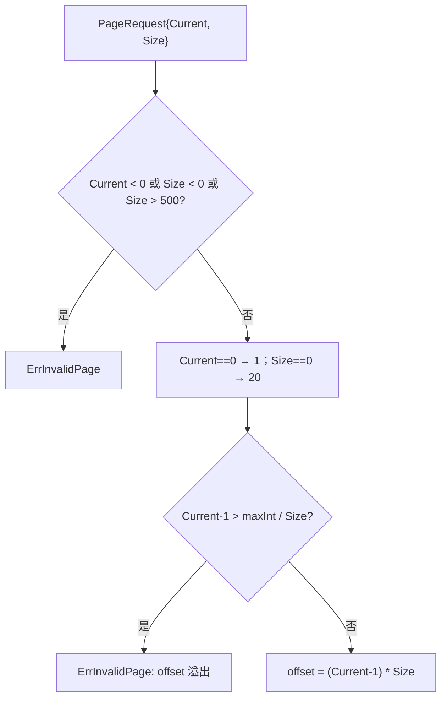
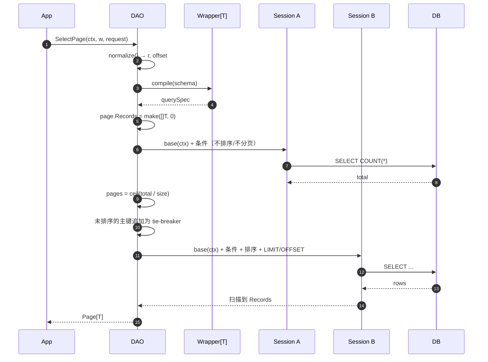

# 04 分页

[返回 Wiki 首页](README.md)

## 1. 组成

| 类型/常量 | 定义位置 | 说明 |
| --- | --- | --- |
| `DefaultPageSize = 20` | [page.go](../../page.go#L5-L8) | 未指定页大小时的默认值 |
| `MaxPageSize = 500` | [page.go](../../page.go#L5-L8) | 单页上限 |
| `PageRequest` | [page.go](../../page.go#L11-L14) | 一基页码请求：`Current`、`Size` |
| `Page[T]` | [page.go](../../page.go#L16-L22) | 结果：`Records`、`Total`、`Current`、`Size`、`Pages` |
| `PageRequest.normalize` | [page.go](../../page.go#L24-L39) | 参数校验、默认值、offset 计算 |

响应 JSON 契约：

```json
{
  "records": [],
  "total": 0,
  "current": 1,
  "size": 20,
  "pages": 0
}
```

`Page[T].Records` 在成功路径上始终是非 nil 切片（无记录时为空数组，而不是 `null`）。

## 2. 参数规范化



规则：

| 输入 | 结果 |
| --- | --- |
| `Current = 0` | 使用第 1 页 |
| `Size = 0` | 使用 20 条 |
| `Current < 0` / `Size < 0` | `ErrInvalidPage` |
| `Size > 500` | `ErrInvalidPage` |
| `(Current-1) * Size` 溢出 `int` | `ErrInvalidPage` |
| 合法但超出总页数 | 正常执行两次查询，返回空 `Records` |

负数校验发生在默认值替换之前，因此 `Current = -1` 不会被当成第 1 页。

## 3. SelectPage 执行流程



代码要点：

```go
// count：只带过滤条件
spec.apply(d.base(ctx), false).Count(&page.Total)

// select：带排序和分页
db := spec.apply(d.base(ctx), true).Limit(r.Size).Offset(offset)
db.Find(&page.Records)
```

| 约定 | 说明 |
| --- | --- |
| 固定两次查询 | 成功路径始终执行 COUNT 与 SELECT，包括空结果和越界页 |
| count 不带排序/limit/offset | 避免分页子句影响总数 |
| 两次查询使用独立 Session | 防止 count 的 Statement 状态污染 select |
| 主键排序兜底 | 用户未按某主键排序时，追加主键 ASC，降低同值排序导致的翻页重复/遗漏 |
| 失败不返回半成品 | count 或 select 任一失败 → `nil, err` |
| 不做隐式上限 | `PageRequest.Size` 已有 500 上限 |
| 不自动开事务 | 两次查询默认不是同一快照 |

## 4. 分页一致性

默认两条独立语句，在并发写入下：

- `total` 与当前页记录可能来自不同时刻；
- 深分页期间数据插入/删除会导致 OFFSET 位移，出现重复或遗漏。

需要一致快照时，用显式事务包裹：

```go
err := db.WithContext(ctx).Transaction(func(tx *gorm.DB) error {
    dao, err := gormx.NewDAO[User](tx)
    if err != nil {
        return err
    }
    page, err := dao.SelectPage(ctx, query, request)
    // ...
    return err
}, &sql.TxOptions{Isolation: sql.LevelRepeatableRead, ReadOnly: true})
```

具体快照效果取决于数据库、存储引擎与隔离级别，不能跨数据库一概而论。

## 5. 深分页与性能

- 当前 API 使用 `LIMIT ... OFFSET ...`，页码越深，数据库扫描成本越高。
- 精确 COUNT 在大表上也可能昂贵。
- 当前**不提供**游标分页、跳过 count、count 缓存等能力（见 [09 边界](09-boundaries.md#4-后续优化方向)）。
- 建议按真实条件设计索引，并用 `EXPLAIN` 验证；`benchmark_test.go` 只提供本地回归基线，不是生产 SLA。

## 6. 连表分页的差异

`JoinPage[R]` 复用 `PageRequest` 与 `Page[R]`，但语义不同：

| 维度 | `DAO.SelectPage` | `JoinPage` |
| --- | --- | --- |
| 统计单位 | 主实体行数 | **JOIN 结果行数**（可能重复主实体） |
| 投影 | 整个模型 `T` | 必须显式 `Select(...As(...))` 到 DTO `R` |
| 排序兜底 | 主表主键 | **所有参与表**的主键 |
| 去重 | 不存在重复主实体 | 不自动去重 |
| 扫描行为 | GORM 模型扫描 | `Scan` 到 DTO，不执行 `AfterFind` |

一对多场景直接用 `JoinPage` 分页“父实体 + 子集合”会被 LIMIT 截断，正确做法见 [05 连表查询](05-join-query.md#8-分页单位与限制)。

## 7. 使用建议

```go
// HTTP 列表接口
page, err := dao.SelectPage(ctx, query, gormx.PageRequest{
    Current: current,
    Size:    size,
})

// 内部导出/批处理：明确需要全量时用 List，不要伪装成分页
rows, err := dao.List(ctx, query)
```

- 请求参数解析层应拒绝 `size > 500`、负数和非数字输入；`normalize` 是最后一道防线。
- 对空结果，`records` 为 `[]`，前端无需处理 `null`。
- 对深分页，优先收窄条件或限制可翻页深度；需要稳定游标时等待后续增强。

## 8. 源码索引

| 关注点 | 位置 |
| --- | --- |
| 常量与类型 | [page.go](../../page.go#L5-L22) |
| 参数规范化 | [page.go](../../page.go#L24-L39) |
| `SelectPage` | [dao.go](../../dao.go#L162-L199) |
| 连表分页 | [join.go](../../join.go#L325-L366) |
| 分页契约测试 | [gormx_test.go](../../gormx_test.go)、[edge_test.go](../../edge_test.go)、[join_test.go](../../join_test.go) |
| 分页模糊测试 | [fuzz_test.go](../../fuzz_test.go#L16-L40) |
