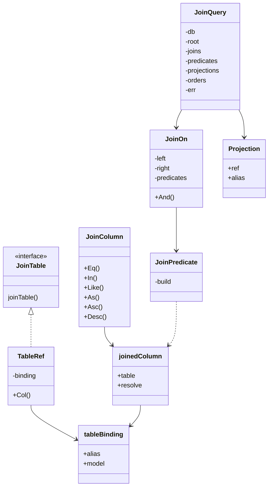
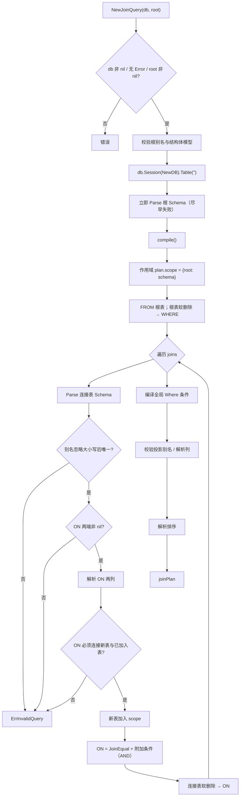
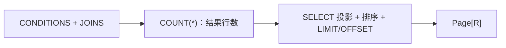

# 05 连表查询：JoinQuery

[返回 Wiki 首页](README.md)

## 1. 定位

`JoinQuery` 是**独立、只读、不可变**的多表平铺查询 API，不改变 `DAO[T]` / `Wrapper[T]` 的单表语义。

适用场景：

- 一对一、多对一的平铺投影（如员工 → 部门）；
- INNER / LEFT JOIN、自连接、多表串联；
- 显式列投影到 DTO；
- 结果行分页。

不适用场景：

- 一对多主实体分页 + 嵌套子集合装配；
- 聚合、GROUP BY/HAVING、DISTINCT、子查询、EXISTS；
- RIGHT/FULL/CROSS JOIN；
- 连表写入、删除、恢复。

源码：

- [join.go](../../join.go)：查询、编译、执行、分页
- [join_field.go](../../join_field.go)：表身份、绑定字段、条件、投影
- 设计与边界：[joins.md](../joins.md)

## 2. 类型模型



| 类型 | 说明 |
| --- | --- |
| `TableRef[T]` | `TableOf[T](alias)` 创建的**表身份**，不是数据库表 |
| `tableBinding` | 别名 + 模型类型；作为作用域 key |
| `JoinColumn[V]` | 绑定表身份与值类型 `V` 的列 |
| `JoinPredicate` | 在 `joinScope` 内编译的条件 |
| `JoinOn` | 一个新表的连接等值条件 + 附加 AND 条件 |
| `Projection` | `列.As(输出别名)` |
| `JoinOrder` | 绑定表身份的排序 |
| `JoinQuery` | 不可变查询描述；错误可延迟到 `compile` |

## 3. 公共 API

### 3.1 表与字段

| API | 签名 | 说明 |
| --- | --- | --- |
| `TableOf` | `TableOf[T any](alias string) TableRef[T]` | 每次调用创建新身份；自连接必须用不同实例与别名 |
| `TableRef.Col` | `(name string) JoinColumn[any]` | 字符串字段版；未做编译期值类型约束 |
| `Bind` | `Bind[T,V](TableRef[T], Column[T,V]) JoinColumn[V]` | 把现有 `Field` 绑定到表实例；模型必须一致 |
| `As` | `(alias string) Projection` | 定义输出别名 |
| `Asc/Desc` | `() JoinOrder` | 排序 |

### 3.2 查询

| API | 签名 | 说明 |
| --- | --- | --- |
| `NewJoinQuery` | `(db *gorm.DB, root JoinTable) (*JoinQuery, error)` | 只接受原始 DB 或事务句柄 |
| `InnerJoin` | `(table JoinTable, on JoinOn) *JoinQuery` | INNER JOIN |
| `LeftJoin` | `(table JoinTable, on JoinOn) *JoinQuery` | LEFT JOIN |
| `Where` | `(...JoinPredicate) *JoinQuery` | 顶层 AND 条件 |
| `WhereIf` | `(bool, ...JoinPredicate) *JoinQuery` | 条件添加 |
| `Select` | `(...Projection) *JoinQuery` | **替换**投影，必须显式列 |
| `OrderBy` | `(...JoinOrder) *JoinQuery` | 追加排序 |
| `Count` | `(ctx) (int64, error)` | 统计 JOIN 结果行，不需要投影 |
| `JoinList[R]` | `(ctx, *JoinQuery) ([]R, error)` | 平铺结果，无隐式上限 |
| `JoinPage[R]` | `(ctx, *JoinQuery, PageRequest) (*Page[R], error)` | 结果行分页 |

### 3.3 条件构造

```go
gormx.On(e.Col("DepartmentID"), d.Col("ID")).
    And(d.Col("TenantID").Eq(tenantID))

gormx.JoinEqual(e.Col("TenantID"), d.Col("TenantID"))
gormx.JoinAll(p1, p2)  // AND
gormx.JoinAny(p1, p2)  // OR
```

`JoinColumn[V]` 支持：`Eq/Ne/Gt/Ge/Lt/Le/Between/In/NotIn/Like/NotLike/IsNull/IsNotNull`。

与单表 API 的差异：

| 差异 | 说明 |
| --- | --- |
| `In/NotIn` | 可变参数：`id.In(ids...)` |
| `Like` | 不限制列值类型为 string；SQL 类型兼容性由调用者负责 |
| 空集合 | 与单表一致：空 IN 恒假、空 NOT IN 恒真 |
| `Like` 通配符 | `%`、`_` 保留数据库语义 |

## 4. 查询构建示例

```go
e := gormx.TableOf[Employee]("e")
d := gormx.TableOf[Department]("d")

query, err := gormx.NewJoinQuery(db, e)
if err != nil {
    return err
}

query = query.
    LeftJoin(d, gormx.On(e.Col("DepartmentID"), d.Col("ID")).
        And(d.Col("TenantID").Eq(tenantID))).
    Where(e.Col("TenantID").Eq(tenantID)).
    WhereIf(name != "", gormx.Bind(e, employeeName).Like("%"+name+"%")).
    Select(
        gormx.Bind(e, employeeID).As("employee_id"),
        gormx.Bind(e, employeeName).As("employee_name"),
        d.Col("Name").As("department_name"),
    ).
    OrderBy(gormx.Bind(e, employeeID).Asc())

page, err := gormx.JoinPage[EmployeeDepartment](ctx, query, request)
```

完整可编译示例：[examples/joins/query.go](../../examples/joins/query.go)。

## 5. 编译流程



关键校验：

| 校验 | 失败结果 |
| --- | --- |
| 别名格式 `^[A-Za-z_][A-Za-z0-9_]{0,62}$` | `ErrInvalidQuery` |
| 同一查询中别名忽略大小写重复 | `ErrInvalidQuery` |
| `On` 两端为 nil | `ErrInvalidQuery` |
| `On` 未连接“新表 ↔ 已有表” | `ErrInvalidQuery`（不能引用未来表、不能漏掉新表） |
| 未知模型级 QueryClause | `ErrInvalidQuery`（fail closed） |
| 投影别名非法或重复 | `ErrInvalidQuery` |
| 投影字段未绑定、越出作用域 | `ErrInvalidField` |
| DTO 字段不可读或无对应列 | `ErrInvalidField` |
| `JoinList/JoinPage` 未提供投影 | `ErrInvalidQuery` |

`JoinQuery` 采用“错误可延迟”模式：`addJoin` 等链式方法可能把错误存进 `q.err`，在 `compile` 时统一返回；因此**必须处理最终执行方法的 error**。

## 6. ON 条件规则

- `On(left, right)` 必须提供**一个字段等值**，连接本次新加入的表与已经存在的表。
- 附加条件通过 `on.And(predicates...)` 添加，始终与基础等值条件 AND。
- 关联列可以是可空外键（如 `*uint`），但两列 SQL 类型兼容性由调用者负责。
- 不支持 CROSS JOIN，也不接受任意 SQL 字符串作为 ON。

复合关联示例：

```go
on := gormx.On(e.Col("DepartmentID"), d.Col("ID")).
    And(gormx.JoinEqual(e.Col("TenantID"), d.Col("TenantID")))
```

## 7. DTO 与投影

```go
type EmployeeDepartment struct {
    EmployeeID     uint    `json:"employeeId"`
    EmployeeName   string  `json:"employeeName"`
    DepartmentName *string `json:"departmentName"`
}
```

规则：

| 规则 | 说明 |
| --- | --- |
| DTO 必须是非指针结构体 | 否则 `ErrInvalidModel` |
| 必须显式 `Select` | 不支持 `SELECT *` |
| 每个输出必须 `As(alias)` | 别名符合标识符规则且唯一 |
| 别名必须匹配 DTO 可读 DB 字段 | 支持 `gorm:"column:..."` 与命名策略 |
| 未选择的 DTO 字段 | 保持零值 |
| LEFT JOIN 可空列 | 用 `*string`、`*uint`、`sql.Null*` 接收 |
| 扫描方式 | `Scan`，不执行源模型或 DTO 的 `AfterFind` |
| DTO 软删除条件 | 不应用（DTO 只是投影，不是持久化模型） |

别名不匹配会在执行前报错，避免“查询成功但字段永远是零值”的静默错误。

## 8. 分页单位与限制

`JoinPage[R]` 的分页单位始终是 **JOIN 结果行**：



| 场景 | 结果 |
| --- | --- |
| 一个员工两个部门（一对多） | 返回 2 行，`total = 2`，**不会去重为 1 个员工** |
| 主表软删除记录 | 根表条件在 WHERE，排除 |
| 连接表软删除记录 | 条件在 ON；LEFT JOIN 保留主行，关联列输出 NULL |
| 分页排序兜底 | 为**每张参与表**的主键追加 ASC |
| 越界页 | 仍执行 COUNT + SELECT，返回空 `records` |

如果需要“分页完整主实体 + 批量加载子集合”，当前阶段不提供该语义；应使用原生 GORM `Preload`，或等待后续“主实体 ID 分页 + 批量加载”能力。

## 9. 软删除与权限

| 表位置 | 软删除条件位置 | 原因 |
| --- | --- | --- |
| 根表 | `WHERE` | 主表不可见记录应整体排除 |
| 连接表（LEFT/INNER） | `ON` | 保留合法主行，关联不可见时输出 NULL |
| 调用者额外把连接表条件放 `WHERE` | 显式 SQL 语义 | 会主动过滤 NULL 扩展行，属于业务选择 |

实现读取模型 Schema 的 `QueryClauses`：

- 支持 GORM 原生 `SoftDeleteQueryClause` 及其 `ZeroValue`；
- 遇到其他模型级 QueryClause 返回错误，**不会静默丢弃可见性约束**；
- 第三方标志位软删除、租户插件等需要单独适配验证。

**权限不是全局插件**：`NewJoinQuery` 同样只接收原始 DB/事务句柄，权限条件必须逐表显式加入：

```go
query = query.
    LeftJoin(d, gormx.On(e.Col("DepartmentID"), d.Col("ID")).
        And(d.Col("TenantID").Eq(tenantID))).
    Where(e.Col("TenantID").Eq(tenantID))
```

`tenantID` 必须来自可信身份上下文，不能直接接受客户端任意租户参数。

## 10. 事务与并发

```go
err := db.WithContext(ctx).Transaction(func(tx *gorm.DB) error {
    query, err := gormx.NewJoinQuery(tx, e)
    if err != nil {
        return err
    }
    // 配置 Join / 权限 / 投影，再调用 JoinPage
    return nil
})
```

- 事务句柄会被保留；`NewDB` 只清理预挂语句，不丢事务。
- `JoinQuery` 不可变，可并发复用；`compile()` 每次生成独立 `joinPlan`。
- 不要并发修改传入的指针或切片元素。

## 11. 当前不支持

- 一对多主实体分页与嵌套装配；
- EXISTS 构造器；
- GROUP BY / HAVING、DISTINCT、聚合表达式；
- RIGHT / FULL / CROSS JOIN；
- 子查询表、窗口函数；
- JOIN 写入、删除、恢复、`Unscoped`；
- 全局租户/权限插件自动注入；
- 任意原生 SQL 片段或 `gorm.Expr` 作为 ON/WHERE。

需要上述能力时，使用原生 GORM，并继续由 gormx 处理简单只读投影。

## 12. 源码索引

| 关注点 | 位置 |
| --- | --- |
| `JoinQuery` 定义与构造 | [join.go](../../join.go#L15-L67) |
| 不可变链式方法 | [join.go](../../join.go#L69-L123) |
| `joinPlan` 与软删除构造 | [join.go](../../join.go#L125-L160) |
| 编译主流程 | [join.go](../../join.go#L162-L250) |
| 基础 DB / Count | [join.go](../../join.go#L252-L276) |
| DTO 校验与扫描 | [join.go](../../join.go#L278-L323) |
| JoinList / JoinPage | [join.go](../../join.go#L325-L366) |
| 表身份与绑定 | [join_field.go](../../join_field.go#L14-L78) |
| JoinColumn / 投影 / 排序 | [join_field.go](../../join_field.go#L80-L127) |
| JoinPredicate / 分组 / JoinEqual / JoinOn | [join_field.go](../../join_field.go#L129-L217) |
| 示例 | [examples/joins/query.go](../../examples/joins/query.go) |
