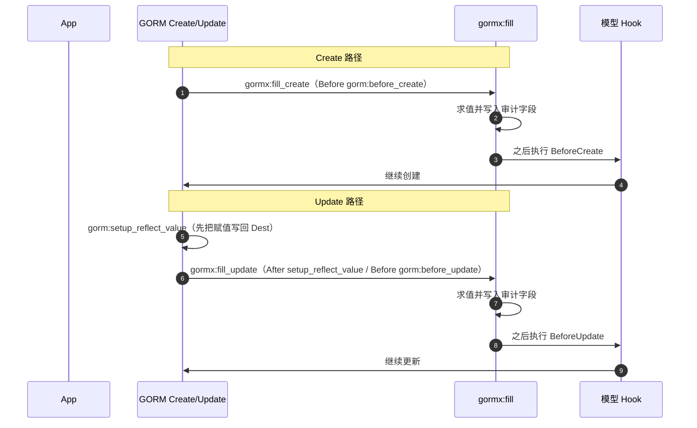
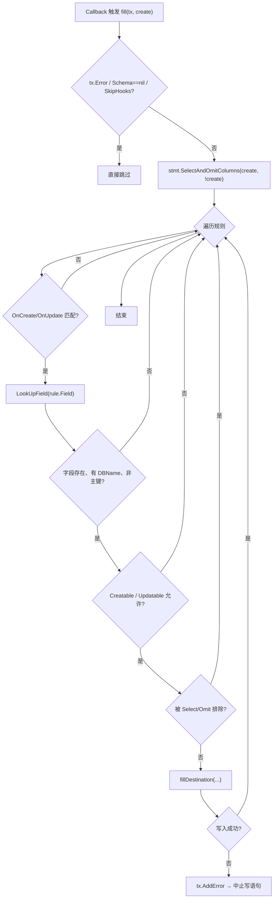
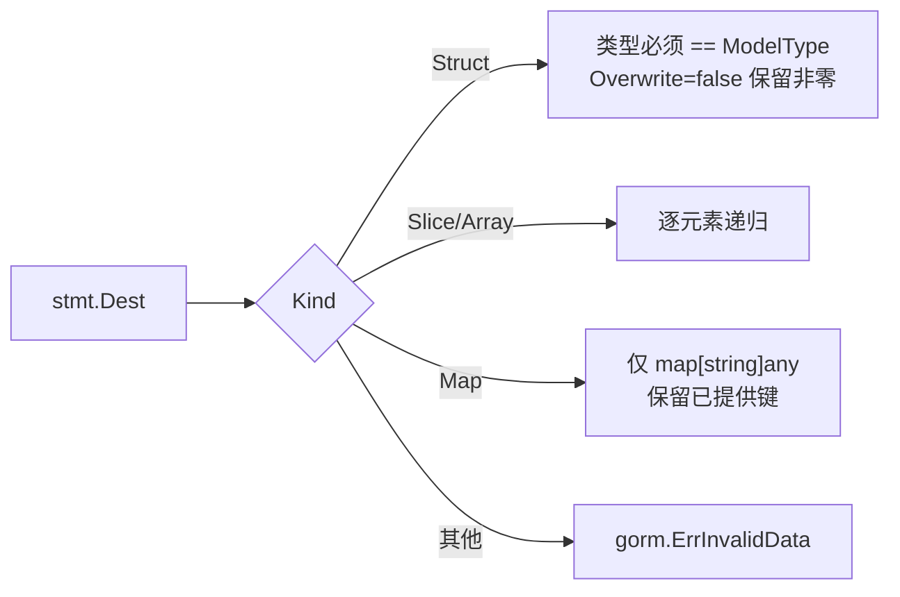

# 06 填充插件与软删除

[返回 Wiki 首页](README.md)

## 1. 两条独立能力

| 能力 | 实现 | 是否可选 |
| --- | --- | --- |
| 审计字段填充 | `FillPlugin`（GORM Callback 插件） | 是，`db.Use(...)` 注册 |
| 软删除 | GORM 原生 `gorm.DeletedAt` | 是，模型声明即启用 |

它们都不改变 `DAO[T]` 的调用方式。

源码：[fill.go](../../fill.go)

## 2. FillRule

```go
type FillRule struct {
    Field     string
    OnCreate  bool
    OnUpdate  bool
    Overwrite bool
    Value     func(context.Context) (any, error)
}
```

| 字段 | 说明 |
| --- | --- |
| `Field` | 模型字段名或 DB 列名；未映射字段会被跳过，便于共享规则 |
| `OnCreate` / `OnUpdate` | 至少启用一个，否则注册时报错 |
| `Overwrite` | `false` 保留已有非零结构体字段和已提供的 map 键（含显式零值） |
| `Value` | 每次写语句求值；从 `context.Context` 获取可信身份，不从 Header 直接取 |

构造：

```go
plugin := gormx.NewFillPlugin(
    gormx.FillRule{Field: "CreatedBy", OnCreate: true, Value: actor},
    gormx.FillRule{
        Field: "UpdatedBy", OnCreate: true, OnUpdate: true,
        Overwrite: true, Value: actor,
    },
)
if err := db.Use(plugin); err != nil {
    return err
}
```

注册必须在服务开始并发处理请求之前完成。

## 3. Hook 顺序



选择这个顺序的原因：

- Create：模型 `BeforeCreate` 能看到已填充的审计字段。
- Update：先让 GORM 把 `Updates` 的赋值写回目标结构体，再填充，避免覆盖或读不到已有值。
- 两条路径都在模型 Hook 之前，Hook 可基于完整字段做校验。

## 4. 填充执行流程



关键实现点：

| 点 | 行为 |
| --- | --- |
| 值求值次数 | 每个规则在**每条写语句**内最多求值一次（闭包内 `resolved` 记忆） |
| 批量写入 | 同一条 `CreateInBatches` 语句内，多个实体共享一次求值结果 |
| 错误传播 | `Value` 返回错误或写入失败 → `tx.AddError`，阻止写入 |
| 跳过条件 | `SkipHooks`、无 Schema、`tx.Error` 已存在 |
| 字段权限 | 通过 `SelectAndOmitColumns` 判断，尊重 `Select/Omit` |
| 不可更新字段 | `!Updatable` / `!Creatable` 跳过 |
| 主键 | 跳过，不允许填充主键 |

## 5. 写入目标

`fillDestination` 支持三类目标：

| 目标 | 行为 |
| --- | --- |
| 结构体 `T` | 必须是模型类型且可寻址；`Overwrite=false` 且字段非零 → 保留；否则 `field.Set` |
| 结构体切片/数组 `[]T` | 逐元素递归填充 |
| `map[string]any` | 必须是 `map[string]any`；`Overwrite=false` 时已有 `Field` 或 `DBName` 键 → 保留；否则删除 Go 字段名键，写入 DB 列名键 |



注意事项：

- 不支持把任意 DTO 当作模型更新；结构体类型必须与模型一致。
- map 的目标类型必须是 `map[string]any`，其他 map 类型返回 `gorm.ErrInvalidData`。
- 指针为 nil 时返回 `gorm.ErrInvalidValue`。
- `Overwrite=false` 的“保留”包括显式零值：map 中已有 `"Status": 0` 也会被视为业务提供的值。

## 6. 软删除

### 6.1 原生行为

```go
type User struct {
    ID        uint
    DeletedAt gorm.DeletedAt `gorm:"index"`
}
```

| 操作 | 行为 |
| --- | --- |
| 查询 / count / 分页 | 自动追加 `deleted_at IS NULL` |
| `Delete` | UPDATE `deleted_at`，不是物理删除 |
| 无 `gorm.DeletedAt` 的模型 | 物理 DELETE |
| `BeforeDelete/AfterDelete` | 保持可用，可做删除授权或审计 |
| 恢复 / 物理清理 / 查看已删除 | 显式 `Unscoped()`，应用层单独授权 |

gormx **没有**第二套软删除 Callback，避免与 GORM 竞争。

### 6.2 与填充的关系

删除走 Delete Callback，不会触发 Update 回调，因此：

- `UpdatedBy` 规则不会自动记录“删除人”；
- 需要删除审计时，应使用 `BeforeDelete/AfterDelete` 或独立审计表。

### 6.3 连表查询中的位置

| 表 | 软删除条件位置 |
| --- | --- |
| 根表 | `WHERE` |
| 连接表 | `ON` |

这样 LEFT JOIN 能保留合法主行，把已删除关联输出为 NULL。详见 [05 连表查询](05-join-query.md#9-软删除与权限)。

### 6.4 唯一索引陷阱

已软删除的记录仍占用普通唯一索引。MySQL 对 NULL 的唯一性语义可能允许重复，因此**不能简单假设**“把可空 `deleted_at` 加入唯一索引就能只约束活跃记录”。

可选方案（需按业务设计）：

- 生成列活跃标记 + 唯一索引；
- 归档表；
- 业务侧唯一性校验；
- 独立唯一性设计。

## 7. 安全边界

`FillPlugin` 是**便利机制，不是不可绕过的审计/权限层**：

- 尊重 `SkipHooks`，调用方可以主动跳过；
- 尊重 `Select/Omit`，字段可能被排除；
- 规则中的字段找不到时静默跳过（这是为了共享规则的便利性）；
- 身份必须从可信 Context 获取，不能直接信任外部 Header；
- 审计完整性仍需服务端授权、数据库约束和独立审计存储共同保证。

软删除也不是权限系统：`Delete` 的条件仍要经过 `ErrUnsafeWrite` 检查，但“谁能删什么”必须由应用层决定。

## 8. 源码索引

| 关注点 | 位置 |
| --- | --- |
| `FillRule` / `FillPlugin` | [fill.go](../../fill.go#L12-L32) |
| 注册与 Hook 顺序 | [fill.go](../../fill.go#L34-L48) |
| 规则匹配与字段权限 | [fill.go](../../fill.go#L50-L88) |
| 写入目标处理 | [fill.go](../../fill.go#L90-L139) |
| 软删除原生说明 | [README.md](../../README.md#自动填充与软删除) |
| 连表软删除实现 | [join.go](../../join.go#L145-L160) |
| 填充/软删除测试 | [gormx_test.go](../../gormx_test.go)、[edge_test.go](../../edge_test.go)、[contract_extended_test.go](../../contract_extended_test.go) |
