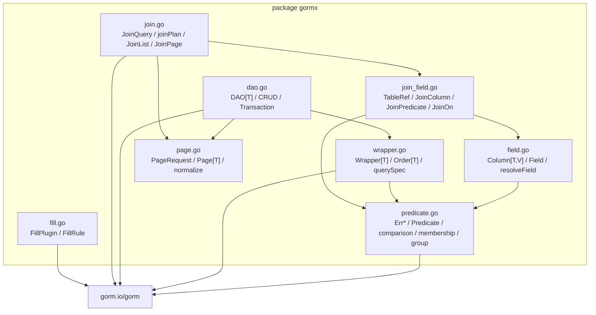
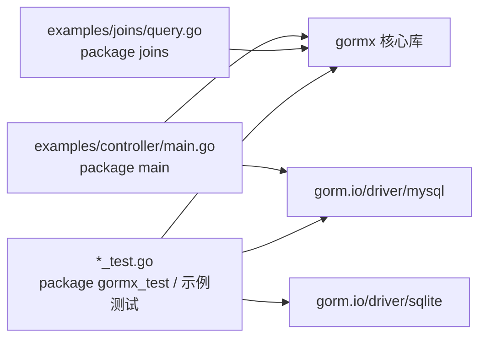

# 07 依赖关系

[返回 Wiki 首页](README.md)

## 1. Go 模块信息

[go.mod](../../go.mod)：

```go
module github.com/heicoder-wuyunbin/gormx

go 1.22
```

| 项 | 当前值 | 说明 |
| --- | --- | --- |
| 模块路径 | `github.com/heicoder-wuyunbin/gormx` | 与 GitHub 仓库地址一致，可通过 `go get` 引用 |
| Go 版本指令 | `go 1.22` | 最低语言/工具链要求；本机验证使用 Go 1.26.1 |
| 包结构 | 根目录单包 `gormx` + 两个示例包 | 核心库不拆子包 |
| 许可证 | Apache License 2.0 | 见仓库根目录 [LICENSE](../../LICENSE) |

## 2. 直接依赖

| 依赖 | 版本 | 使用位置 | 用途 |
| --- | --- | --- | --- |
| `gorm.io/gorm` | v1.31.1 | 核心库、全部示例/测试 | ORM 内核：Schema、Session、Transaction、Callback、clause、软删除 |
| `gorm.io/driver/mysql` | v1.6.0 | [examples/controller](../../examples/controller/main.go)、MySQL 测试 | MySQL 方言与连接 |
| `gorm.io/driver/sqlite` | v1.6.0 | 单元测试、模糊测试、基准、示例测试 | SQLite 方言，零配置内存库 |
| `github.com/go-sql-driver/mysql` | v1.8.1 | [examples/controller/http_test.go](../../examples/controller/http_test.go) | 构造/解析 DSN，创建与删除独立测试数据库 |

**核心库 `package gormx` 只直接依赖 `gorm.io/gorm`**。数据库驱动仅出现在示例与测试中，接入方自行选择驱动。

## 3. 间接依赖

| 依赖 | 版本 | 传递来源 | 作用 |
| --- | --- | --- | --- |
| `github.com/mattn/go-sqlite3` | v1.14.22 | `gorm.io/driver/sqlite` | CGO SQLite 驱动 |
| `github.com/jinzhu/inflection` | v1.0.0 | `gorm.io/gorm` | 表名复数化等命名策略 |
| `github.com/jinzhu/now` | v1.1.5 | `gorm.io/gorm` | 时间辅助 |
| `golang.org/x/text` | v0.20.0 | `go-sql-driver/mysql` | 字符集/编码处理 |
| `filippo.io/edwards25519` | v1.1.0 | `go-sql-driver/mysql` | MySQL 认证相关密码学 |

## 4. 包内文件依赖



| 文件 | 依赖的包内文件 | 被谁依赖 |
| --- | --- | --- |
| `predicate.go` | 无 | `field`、`wrapper`、`dao`（错误值）、`join_field` |
| `field.go` | `predicate` | `join_field`、业务代码、示例 |
| `wrapper.go` | `predicate` | `dao` |
| `page.go` | 无 | `dao`、`join` |
| `dao.go` | `wrapper`、`predicate`、`page` | 业务代码、示例 |
| `join_field.go` | `predicate`、`field` | `join` |
| `join.go` | `join_field`、`page`、`predicate` | 业务代码、示例 |
| `fill.go` | 仅 GORM | 业务启动代码（`db.Use`） |

模块边界：

- 单表链路（`field → wrapper → dao`）与多表链路（`join_field → join`）**不互相执行**；
- `join_field` 复用 `Column`/`Field` 的解析能力，但用自己的 `joinScope` 替换单表 Schema；
- `fill` 独立于 DAO/Wrapper，可单独注册或移除；
- 示例包导入 `gormx`，核心库不反向依赖示例。

## 5. 示例与测试的依赖方向



| 包 | 说明 |
| --- | --- |
| `gormx` | 核心库 |
| `gormx/examples/controller` | 可执行示例 + HTTP/进程测试；直接依赖 MySQL 驱动 |
| `gormx/examples/joins` | 示例包 + SQLite 测试 |
| 根目录 `_test.go` | 外部测试包 `gormx_test`，覆盖 SQLite/MySQL 契约 |

## 6. 版本与兼容性说明

| 项 | 状态 |
| --- | --- |
| Go 1.26.1 / darwin arm64 | 完整功能测试、竞态、模糊测试通过 |
| Go 1.22.12 | 库与处理器测试通过；独立进程默认链接在本机 macOS 26 上出现 `dyld: missing LC_UUID load command`，改用 `-linkmode=external` 后通过 |
| MySQL 8.4.5 | 验证通过（含真实 HTTP 进程） |
| SQLite | 验证通过（CGO） |
| PostgreSQL / SQL Server / Linux / Windows | **未验证** |
| 生产规模、深分页、高并发 | **未验证** |

SQLite 依赖 `mattn/go-sqlite3`，需要：

- `CGO_ENABLED=1`；
- 可用的 C 编译器（macOS 安装 Xcode Command Line Tools 即可）。

若部署环境无法启用 CGO，可把测试/示例切换为纯 Go SQLite 驱动，但当前仓库未做该替换。

## 7. 发布前需要处理

1. ~~把 `module gormx` 改为真实仓库路径~~（已完成：`github.com/heicoder-wuyunbin/gormx`）。
2. ~~确定许可证与版本策略~~（已采用 Apache License 2.0，首个带许可证版本 `v0.1.1`）。
3. 建立 CI 矩阵：Go 版本 × 数据库（至少 SQLite + MySQL）× 竞态 + 短时 fuzz。
4. 固定依赖升级策略，定期运行 `go mod verify`、`go vet`、`go test -race`。

详见 [09 边界与路线图](09-boundaries.md#4-后续优化方向)。

## 8. 源码索引

| 关注点 | 位置 |
| --- | --- |
| 模块与依赖版本 | [go.mod](../../go.mod) |
| 校验和 | [go.sum](../../go.sum) |
| 核心库对外 API | [dao.go](../../dao.go)、[wrapper.go](../../wrapper.go)、[join.go](../../join.go) |
| 示例依赖 | [examples/controller/main.go](../../examples/controller/main.go)、[examples/joins/query.go](../../examples/joins/query.go) |
