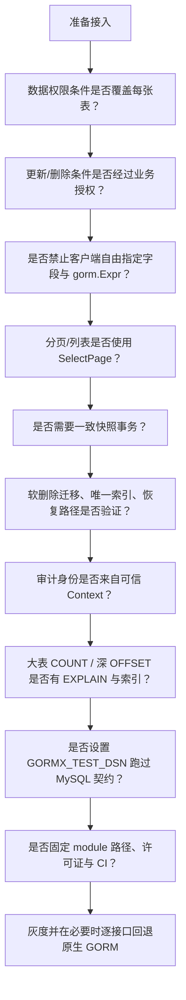

# 09 边界与路线图

[返回 Wiki 首页](README.md)

## 1. 已保证的能力

| 能力 | 保证方式 |
| --- | --- |
| 查询条件不拼接普通值 | `clause` 表达式 + 驱动参数绑定 |
| 只允许模型真实字段 | `schema.LookUpField` / 字段地址解析 |
| 更新保留零值 | `map[string]any` + `Updates` |
| 空条件/恒真条件写保护 | `querySpec.restrictive` |
| 查询状态不跨操作泄漏 | 每次操作独立 Session |
| 分页固定 COUNT + SELECT | `SelectPage` / `JoinPage` |
| 分页无记录返回空数组 | `Records` 初始化为 `make([]T, 0)` |
| Wrapper / JoinQuery 可并发复用 | 不可变副本 |
| 主键排序兜底 | 单表主键 / 连表所有参与表主键 |
| 软删除复用 GORM | 原生 `gorm.DeletedAt`，无竞争回调 |
| 连表可见性不静默丢失 | 未知模型级 QueryClause 直接报错 |

## 2. 明确不保证

### 2.1 安全

| 事项 | 现状 | 要求 |
| --- | --- | --- |
| 多租户/数据权限 | 没有全局租户插件 | 每层查询显式加条件，且每张连表都覆盖 |
| 字段授权 | 字段白名单只校验“是否存在” | 应用层控制哪些字段可被客户端指定 |
| SQL 表达式 | `gorm.Expr` 具有执行 SQL 能力 | 禁止把用户输入包装为表达式 |
| 写保护 | 只做结构级检查 | 不能证明任意条件不会覆盖全表 |
| 审计插件 | 尊重 `SkipHooks`、`Select/Omit` | 不是不可绕过的审计层 |
| 软删除 | 不是权限系统 | 删除授权仍由应用层负责 |

### 2.2 一致性

- `SelectPage` / `JoinPage` 默认是两条独立语句，**不是同一快照**；并发写入下总数与记录可能短暂不一致。
- 需要一致快照时，必须显式使用合适隔离级别的事务。
- 不同数据库、存储引擎、隔离级别的快照行为不同，不能一概而论。

### 2.3 性能

- 精确 COUNT 在大表上成本高。
- `OFFSET` 深分页随页码增长而变慢。
- `benchmark_test.go` 是本地回归基线，不是 MySQL 压测或生产 SLA。
- JOIN 尚无生产性能基线。

### 2.4 类型安全

类型安全是“编译期类型约束 + 运行时 Schema 校验”的组合，不是完整 SQL 类型系统：

- 字段重命名、值类型不匹配、跨模型传条件 → 编译失败；
- 字段是否真实映射、是否被忽略 → 运行时校验；
- 比较运算符是否适用于某数据库类型、值是否满足数据库约束 → 调用者与数据库负责。

### 2.5 数据库与平台矩阵

已实际验证：SQLite、MySQL 8.4.5、Go 1.22.12 / 1.26.1、macOS arm64。

**未验证**：

- PostgreSQL、SQL Server 等其他 GORM 方言；
- Linux / Windows；
- 百万级数据、生产索引、深分页、持续高并发；
- 网络中断、数据库重启、死锁、超时重试、连接池耗尽；
- 分片、全局租户、JOIN 聚合、一对多主实体分页。

## 3. 关键语义边界

### 3.1 ByID

- 只支持**单个**字符串或整数主键。
- 复合主键、UUID 特殊类型、自定义主键类型 → 使用 Wrapper。
- 数字字符串严格解析，避免 MySQL 隐式转换。
- 不提供 `Save`，避免更新失败退化为插入。

### 3.2 更新

- 只接受 `map[string]any`；结构体更新的零值语义不在此 API 内。
- 拒绝未知字段、忽略字段、主键、非 `Updatable` 字段。
- 返回 `RowsAffected`；MySQL 报告“匹配行”还是“实际改变行”受连接参数影响。

### 3.3 删除

- 声明 `gorm.DeletedAt` → 软删除；否则物理删除。
- 恢复、物理清理、查看已删除 → 显式原生 `Unscoped()` + 单独授权。
- 软删除不触发 Update 回调，`UpdatedBy` 不会自动成为“删除人”。
- 已删除记录仍占普通唯一索引，不能假设可空 `deleted_at` 唯一索引能只约束活跃行。

### 3.4 连表

| 能力 | 状态 |
| --- | --- |
| INNER / LEFT JOIN、自连接、多表串联 | 支持 |
| 显式投影到平铺 DTO | 支持 |
| 结果行分页 | 支持 |
| 一对多主实体分页 + 嵌套装配 | 不支持 |
| GROUP BY / HAVING / DISTINCT / 聚合 | 不支持 |
| EXISTS、子查询、窗口函数 | 不支持 |
| RIGHT / FULL / CROSS JOIN | 不支持 |
| JOIN 写入 / 删除 / `Unscoped` | 不支持 |
| 全局权限插件自动注入 | 不支持 |
| 原生 SQL 片段 / `gorm.Expr` 作为 ON/WHERE | 不支持 |

`JoinPage` 的统计单位是 **JOIN 结果行**，不自动去重主实体。分页“父实体 + 完整子列表”会被 LIMIT 截断，应改用原生 `Preload` 或后续“主实体 ID 分页 + 批量加载”。

### 3.5 模型级 QueryClause

`JoinQuery` 支持 GORM 原生 `SoftDeleteQueryClause`；遇到其他模型级 QueryClause **直接报错**，避免静默丢弃可见性约束。

第三方标志位软删除、租户插件、权限插件需要单独适配与测试，不能假设自动兼容。

## 4. 后续优化方向

来源于 [README 后续优化功能](../../README.md#后续优化功能)，按优先级整理：

| 优先级 | 方向 | 目标与验收方向 |
| --- | --- | --- |
| 高 | 租户与数据权限约束 | 设计不能意外丢失的强制过滤机制；评估拒绝带条件 DB 句柄 |
| 高 | CI 与发布工程 | Go/数据库矩阵、竞态、短时 fuzz；确定真实 module 路径、许可证、版本策略 |
| 高 | 分页性能 | 游标分页、可选跳过 count；保留现有 `SelectPage` 两次查询契约 |
| 高 | 乐观锁 | 版本字段条件更新、冲突错误、受影响行数校验与并发覆盖写测试 |
| 中 | 更完整的类型安全 | 生成字段代码、类型安全更新、受约束的排序/比较 API |
| 中 | 关联查询阶段 2 | 主实体 ID 分页后批量加载子集合、EXISTS 筛选、聚合 |
| 中 | 原生 GORM 组合入口 | Scope、预加载、锁、事务选项的受控组合，防状态污染/权限绕过 |
| 中 | 审计与软删除策略 | 删除人/删除时间审计、授权恢复入口、软删除唯一索引方案 |
| 中 | 分配与缓存优化 | 优化不可变 Wrapper 拷贝与字段缓存，保持并发隔离 |
| 中 | 可观测性与故障验证 | 慢查询指标、追踪、连接异常/超时测试；重试需明确事务与幂等边界 |
| 中 | 示例服务工程化 | 配置化监听地址、请求超时、优雅退出；鉴权仍归应用层 |

## 5. 上线前检查清单

逐项说明：

1. **权限**：租户/数据权限必须显式覆盖所有查询与所有连表。
2. **写授权**：不要把“有 Wrapper”误认为“条件安全”；写保护只是结构检查。
3. **字段授权**：禁止把客户端字段名直接传给 `Update`；禁止 `gorm.Expr` 接收用户输入。
4. **分页**：HTTP 列表接口使用 `SelectPage`，不要用无上限的 `List`。
5. **一致性**：需要同快照时显式事务；不要假设默认两次查询一致。
6. **软删除**：先验证历史数据、索引、恢复与物理清理授权。
7. **审计**：操作人来自认证上下文，不信任可伪造 Header。
8. **性能**：用真实条件与数据量做 `EXPLAIN`，不要用本地基准代替生产评估。
9. **MySQL 验证**：跳过 MySQL 测试不等于通过；上线前至少跑一遍真实 MySQL 契约。
10. **发布**：确定真实 module 路径、许可证、版本与 CI 矩阵。
11. **回退**：按接口逐步接入；出问题可局部退回原生 GORM，无需整体迁移。

## 6. 何时应直接用原生 GORM

| 需求 | 建议 |
| --- | --- |
| 聚合、窗口、子查询、复杂 SQL | 原生 GORM / `Raw` |
| 一对多嵌套装配、`Preload` | 原生 GORM |
| 锁（`FOR UPDATE`）、`SkipLocked` | 原生 GORM 事务 |
| 分片、复杂租户 Scope | 原生 GORM |
| 软删除恢复、物理清理 | 原生 `Unscoped()` + 授权 |
| 连表写入/删除 | 原生 GORM |
| 需要自定义模型级 QueryClause | 原生 GORM，或先为 JoinQuery 做适配 |

gormx 的目标是规范常规读写，不是覆盖 GORM 全部能力。

## 7. 相关文档

- [01 架构](01-architecture.md)
- [03 DAO 与 CRUD](03-dao-crud.md#7-写保护)
- [05 连表查询](05-join-query.md#11-当前不支持)
- [06 填充与软删除](06-fill-and-soft-delete.md#7-安全边界)
- [design.md](../design.md#7-上线前必须明确的边界)
- [joins.md](../joins.md#验证与后续)
- [README](../../README.md#后续优化功能)