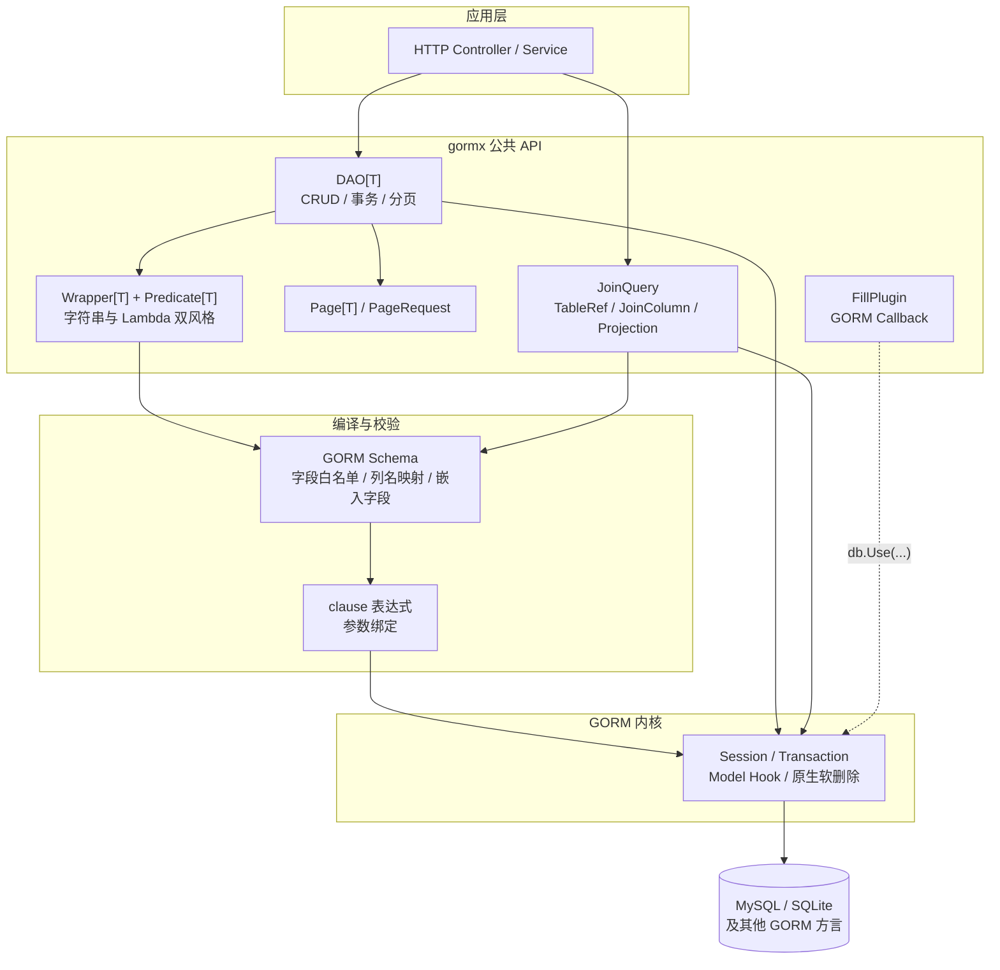

# gormx Code Wiki

> 本 Wiki 依据仓库源码、测试与既有设计文档整理，面向需要阅读、接入或维护 gormx 的工程师。
> 对照版本：`gorm.io/gorm v1.31.1`、Go 1.22+（本机验证 Go 1.26.1）；整理日期：2026-10-26。
> 代码是最终事实来源；文档中的行为描述若与源码冲突，以源码与测试为准。

## 1. 项目定位

gormx 是 GORM 之上的**轻量增强层**，借鉴 MyBatis-Plus 的使用体验，提供四类能力：

| 能力 | 入口 | 解决的问题 |
| --- | --- | --- |
| 不可变条件构造 | `Wrapper[T]`、`Predicate[T]`、`Column[T,V]` | 动态筛选不拼 SQL、条件可复用、字段白名单校验 |
| 泛型 DAO | `DAO[T]` | 统一 CRUD、批量、条件更新/删除、事务入口 |
| 一次调用分页 | `PageRequest`、`Page[T]`、`SelectPage` | 统一 count + limit、参数校验、主键排序兜底 |
| 可选写扩展 | `FillPlugin`、原生 `gorm.DeletedAt` | 审计字段填充；软删除完全复用 GORM |

它**不重新实现 ORM**：连接池、事务、模型 Hook、软删除、方言 SQL 生成仍由 GORM 负责。复杂查询（聚合、预加载、锁、子查询）应直接使用原生 GORM。

设计理念是**组合而非继承**：

```text
DAO[T]            执行入口与 Session 隔离
Wrapper[T]        条件与排序的不可变描述
Predicate[T]      绑定模型的条件单元
Column[T,V]       编译期字段与值类型约束
Page[T]           分页结果载体
FillPlugin        GORM Callback 扩展写行为
JoinQuery         独立的只读多表投影查询
```

## 2. 文档导航

| 文档 | 内容 | 适合读者 |
| --- | --- | --- |
| [01 整体架构](01-architecture.md) | 分层、请求生命周期、关键设计决策、错误模型、并发模型 | 所有人，先读 |
| [02 条件引擎](02-wrapper-query.md) | `Wrapper`/`Predicate`/`Column`/`Field`、不可变语义、`restrictive`、编译流程 | 使用或扩展查询 API |
| [03 DAO 与 CRUD](03-dao-crud.md) | 构造边界、Session 隔离、CRUD/ByID/事务、写保护 | 业务接入 |
| [04 分页](04-pagination.md) | `PageRequest`/`Page[T]`、参数规范化、两次查询契约 | 列表接口开发 |
| [05 连表查询](05-join-query.md) | `TableOf`/`Bind`/`JoinQuery`、ON 作用域、DTO 投影、软删除位置、结果行分页 | 多表只读查询 |
| [06 填充与软删除](06-fill-and-soft-delete.md) | `FillPlugin` 规则/Hook 顺序/写入目标、原生软删除与删除 Hook | 审计与删除策略 |
| [07 依赖关系](07-dependencies.md) | Go 模块、第三方依赖、包内文件依赖图、兼容性说明 | 维护者、发布负责人 |
| [08 运行与测试](08-run-and-test.md) | 环境准备、构建、测试、MySQL/HTTP 集成测试、示例启动 | 开发、CI、验收 |
| [09 边界与路线图](09-boundaries.md) | 已保证/未保证的能力、安全边界、待实现事项 | 架构评审、上线评估 |

既有设计说明保留在 [design.md](../design.md) 与 [joins.md](../joins.md)，本 Wiki 与其互补：design 文档解释“为什么这样设计”，Wiki 解释“代码如何组织、如何运行”。

## 3. 架构总览



要点：

1. **单表路径**：`DAO[T]` 把 `Wrapper[T]` 编译为 `clause.Expression`，再交给 GORM 生成方言 SQL。
2. **多表路径**：`JoinQuery` 独立维护表别名作用域，自己拼装 `FROM/JOIN/ON/WHERE/SELECT` 的 `clause` 结构，仍由 GORM 执行与参数绑定。
3. **写扩展**：`FillPlugin` 只注册 GORM Callback，不改变 DAO 调用方式。
4. **软删除**：完全使用 GORM 原生 `gorm.DeletedAt`，gormx 没有第二套删除 SQL 改写逻辑。

## 4. 模块与文件职责

| 文件 | 职责 | 核心类型 / 函数 |
| --- | --- | --- |
| [dao.go](../../dao.go) | 泛型执行入口，Session/事务隔离 | `DAO[T]`、`NewDAO`、`SelectPage`、`Update`、`Transaction` |
| [wrapper.go](../../wrapper.go) | 不可变查询构建器与编译 | `Wrapper[T]`、`Order[T]`、`querySpec`、`compile` |
| [predicate.go](../../predicate.go) | 条件单元、错误值、参数绑定、括号分组 | `Predicate[T]`、`comparison`、`membership`、`All/Any`、`Err*` |
| [field.go](../../field.go) | Lambda 字段选择器，编译期值类型约束 | `Column[T,V]`、`Field`、`resolveField` |
| [page.go](../../page.go) | 分页请求与结果 | `PageRequest`、`Page[T]`、`normalize` |
| [fill.go](../../fill.go) | 审计字段填充插件 | `FillRule`、`FillPlugin`、`fillDestination` |
| [join.go](../../join.go) | 多表只读查询与结果行分页 | `JoinQuery`、`joinPlan`、`JoinList`、`JoinPage` |
| [join_field.go](../../join_field.go) | 表实例、绑定字段、ON/WHERE 条件、投影 | `TableRef[T]`、`JoinColumn[V]`、`JoinOn`、`Bind` |
| [examples/controller](../../examples/controller/main.go) | 三种写法的 HTTP 对照示例 | `/before/users`、`/users`、`/lambda/users` |
| [examples/joins](../../examples/joins/query.go) | 租户隔离的连表分页示例 | `Employee`、`Department`、`EmployeeDepartment` |

## 5. 最小可用示例

```go
dao, err := gormx.NewDAO[User](db)   // 传入原始 DB 或事务句柄
if err != nil {
    return err
}

query := gormx.NewWrapper[User]().
    LikeIf(name != "", "Name", "%"+name+"%").
    OrderByDesc("Age")

page, err := dao.SelectPage(ctx, query, gormx.PageRequest{Current: 1, Size: 20})
```

Lambda 风格使用字段选择器，把字段名与值类型绑定到编译期：

```go
var UserAge = gormx.Field(func(u *User) *int { return &u.Age })

q := gormx.NewLambda[User]().Where(UserAge.Ge(18))
// UserAge.Eq("18") 无法编译
```

## 6. 本地验证

```sh
go build ./...          # 编译
go test -count=1 ./...  # SQLite 契约、示例、编译期类型检查
go vet ./...            # 静态检查
```

截至 2026-10-26，在 Go 1.26.1 / macOS arm64 上 `go build ./...`、`go vet ./...`、`go test -count=1 ./...` 均通过。MySQL 与真实 HTTP 进程测试需额外环境变量，详见 [08 运行与测试](08-run-and-test.md)。

## 7. 阅读建议

- **只想接入读写接口**：读 [03 DAO](03-dao-crud.md) + [04 分页](04-pagination.md)，再按需看 [02 条件引擎](02-wrapper-query.md)。
- **需要多表投影**：读 [05 连表查询](05-join-query.md)，注意“分页单位是 JOIN 结果行”。
- **关注审计/删除**：读 [06 填充与软删除](06-fill-and-soft-delete.md)。
- **做架构或上线评审**：读 [01 架构](01-architecture.md) + [09 边界](09-boundaries.md)。
